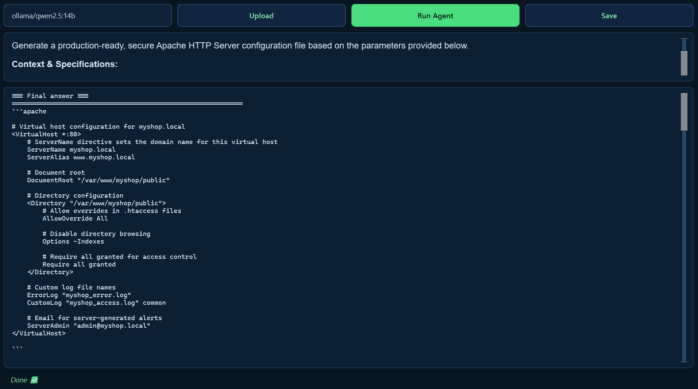
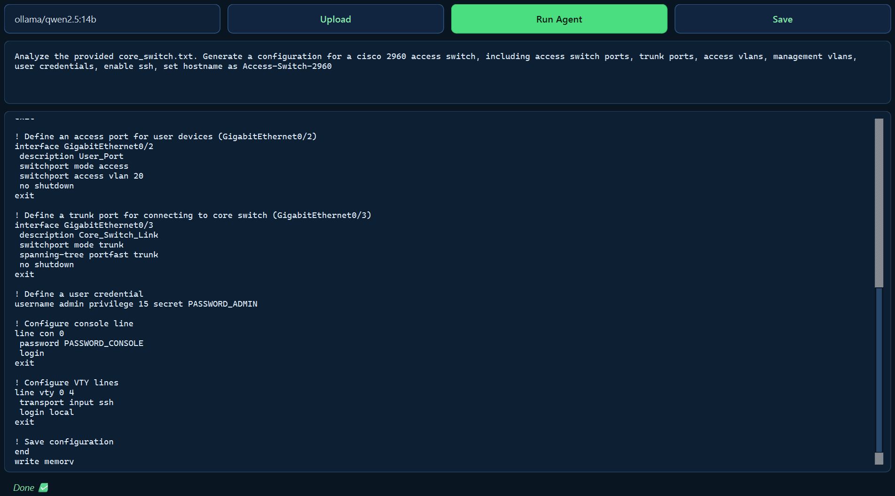
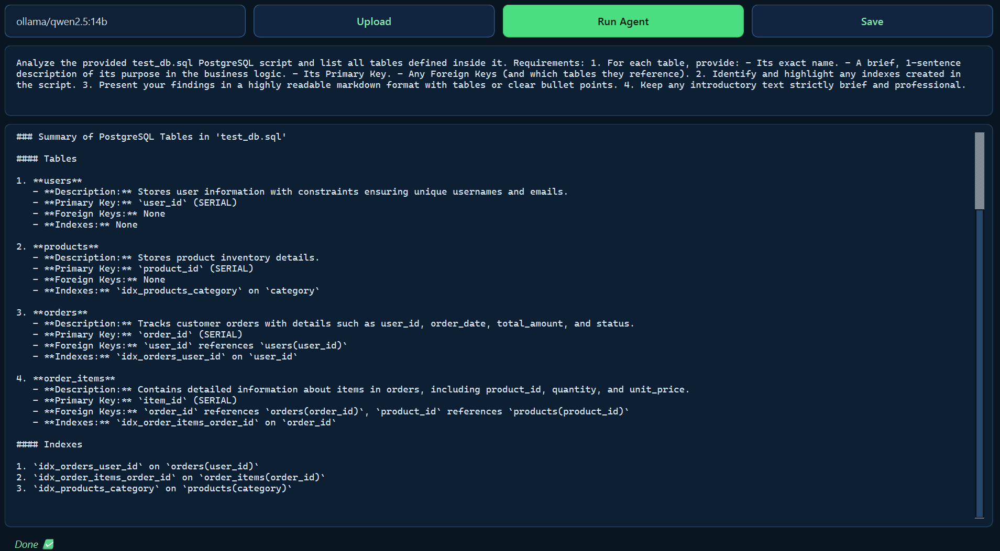

# RoboAdmin-AI

!!!Application is still under development!!!

RoboAdmin-AI is a local multi-agent AI workbench for IT operations. It runs entirely on your machine — no cloud, no API keys, no data leaving your network.
Built with PySide6 + smolagents + Ollama.

To install:

# Windows

Download .exe file:
https://github.com/Evgenii-lin/RoboAdmin-AI/releases

```cmd
make folder RoboAdmin (for Example)
git clone https://github.com/Evgenii-lin/RoboAdmin-AI.git RoboAdmin
cd RoboAdmin
python-3.12 -m venv .venv
.venv\Scripts\activate
pip install -r requirements.txt
python main.py
```

# Linux / macOS
```bash
make folder RoboAdmin (for Example) 
git clone https://github.com/Evgenii-lin/RoboAdmin-AI.git RoboAdmin
cd RoboAdmin
python3.12 -m venv .venv
source .venv/bin/activate
pip install -r requirements.txt
python main.py
```


##System engineering/administration


##Network Engineering


##DBA or SQL queries



Recommended model - Qwen2.5:14b or above. Install Ollama from official website. 

Three specialised agents collaborate under a manager:

1. *System Engineer – service checks, Linux config generation, Dockerfiles.
2. *Network Engineer – Network audits, config creating and parsing.
3. *DBA Engineer – Schema inspection & read-only SQL queries.

Some examples how to use:

Server config:
1. Generate a production-ready, secure Apache HTTP Server configuration file based on the parameters below.

2. Network config based on a file(if exists):
2.1 Analyze the provided core_switch.txt. Generate a configuration for a Cisco 2960 access switch, including access.
2.2 switch ports, trunk ports, access vlans, management vlans,user credentials, enable ssh, set hostname as Access-Switch-2960.

3. Database analysis or sql queries:
3.1 Analyze the provided test_db.sql PostgreSQL script and list all tables defined inside it. 
3.2 Requirements: 
1. For each table, provide: -It's exact name. - A brief, 1-sentence description of its purpose in the buisness logic.
2. Identify and highlight any indexes created in the script.
3. Present your findings in a highly readable markdown format with tables or clear bullet points.

4. !!!May not work properly currently!!!
4.1 Test configuration in Docker(required Docker installed and running):
1. Configure Nginx(8080) and test endpoints in Docker.


5. Point it at your .txt, .cfg files, a Docker socket, or a local database and ask questions in plain English. 
5.1 Everything executes locally via Ollama (Qwen 2.5 / Llama 3 / Mistral — your pick).
